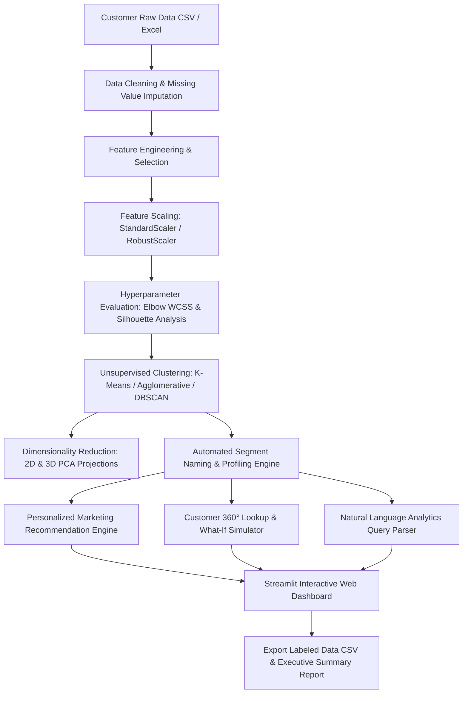

# AI-Based Customer Segmentation & Personalized Marketing Recommendation System
**AIML Mini-Project Final Report & Academic Documentation**

---

## 1. Project Overview & Abstract
In modern retail and e-commerce enterprises, acquiring and retaining customers requires personalized engagement rather than generic blast marketing. **SmartSegment AI** is an end-to-end unsupervised machine learning system that ingests customer behavioral transaction data, identifies intrinsic purchasing patterns, clusters customers into distinct behavioral segments, and automatically generates business personas paired with targeted marketing playbooks.

The system supports **dual dataset modes**:
1. **Online Retail (RFM Analysis):** Recency, Frequency, Monetary value (realistic transaction-level behavioral modeling).
2. **Mall Customer Segmentation:** Age, Annual Income, and Spending Score (2D/3D demographic benchmark).
3. **Custom CSV Ingestion:** Flexible schema mapping with automated missing value handling and scaling.

---

## 2. System Architecture & Data Pipeline



---

## 3. Mathematical Foundations & Machine Learning Formulations

### 3.1 K-Means Clustering
K-Means partitions $N$ observations into $K$ disjoint clusters $S = \{S_1, S_2, \dots, S_K\}$, minimizing the Within-Cluster Sum of Squares (WCSS / Inertia):

$$\text{WCSS} = \sum_{j=1}^{K} \sum_{x \in S_j} ||x - \mu_j||^2$$

where $\mu_j$ is the centroid (mean) of points in cluster $S_j$.

### 3.2 Feature Standardization
Because Euclidean distance is sensitive to feature magnitudes, we apply z-score standardization:

$$z = \frac{x - \mu}{\sigma}$$

This prevents high-magnitude features (e.g., Monetary spending in thousands) from overpowering lower-magnitude features (e.g., purchase frequency).

### 3.3 Silhouette Analysis
The Silhouette Coefficient $s(i)$ for sample $i$ measures cluster cohesion vs separation:

$$s(i) = \frac{b(i) - a(i)}{\max(a(i), b(i))}$$

- $a(i)$: Mean intra-cluster distance between point $i$ and all other points in the same cluster.
- $b(i)$: Mean nearest-cluster distance between point $i$ and the points in the closest neighboring cluster.
- Values range from $-1$ to $+1$, where values $> 0.5$ indicate well-separated, distinct clusters.

### 3.4 RFM Analysis Principles
- **Recency ($R$):** Number of days since the customer's last purchase. (Lower is better).
- **Frequency ($F$):** Total count of completed transactions. (Higher is better).
- **Monetary ($M$):** Cumulative total spending in USD/currency. (Higher is better).

---

## 4. Key Innovations Implemented

1. **Automated Segment Naming (Innovation 1):**
   - Eliminates generic labels like "Cluster 0" or "Cluster 1".
   - Dynamically evaluates centroid statistics against global dataset medians to generate meaningful business personas: *Champions & High-Value VIPs*, *Loyal Frequent Shoppers*, *At-Risk Inactive Spenders*, and *Hibernating / Budget-Conscious*.

2. **Personalized Marketing Playbooks (Innovation 2):**
   - Translates cluster personas into actionable marketing blueprints containing:
     - Strategic campaign objectives (Retention, Upsell, Activation, Churn Prevention)
     - Optimal delivery channels (VIP concierge, automated push drips, SMS flash sales)
     - Tailored incentive structures & discount thresholds

3. **Multi-Algorithm Comparison (Innovation 3):**
   - Supports switching between **K-Means**, **Hierarchical (Agglomerative)**, and **DBSCAN** to observe how algorithmic assumptions affect cluster boundaries.

4. **Customer 360° Lookup & 'What-If' Migration Simulator (Innovation 4):**
   - Real-time customer inspection against cluster benchmarks.
   - Interactive slider simulation allowing marketing managers to adjust hypothetical spending or frequency and witness real-time cluster migration.

5. **Natural Language Analytics Querying (Innovation 5):**
   - Allows business stakeholders to query their customer base in natural language without writing SQL or Pandas syntax (e.g., *"Which customer segment spends the most?"*, *"Who are the at-risk customers?"*).

---

## 5. College Viva Voce & Presentation Q&A Guide

**Q1: Why is customer segmentation considered an unsupervised learning problem?**
> *Answer:* Customer segmentation does not have pre-existing "ground truth" labels in the dataset. The algorithm must autonomously discover latent natural groupings and similarities directly from the mathematical feature space.

**Q2: Why must we scale features before applying K-Means?**
> *Answer:* K-Means relies on Euclidean distance. If one feature has values between 1 and 100 (e.g., Frequency) while another has values between $1,000 and $10,000 (e.g., Monetary), the distance metric will be overwhelmingly dominated by the Monetary feature. Standardization ensures each feature contributes proportionally.

**Q3: How do you determine the optimal number of clusters ($k$)?**
> *Answer:* We use two complementary techniques: the **Elbow Method**, looking for the inflection point in the Within-Cluster Sum of Squares (Inertia curve), and the **Silhouette Score**, which mathematically quantifies separation and compactness across candidate values of $k$.

**Q4: What is the primary limitation of K-Means and how does your project address it?**
> *Answer:* K-Means assumes spherical clusters of similar size and is sensitive to outliers. Our application addresses this by providing alternative clustering options like **Hierarchical Agglomerative Clustering** and **DBSCAN** (which can isolate noise points), alongside RobustScaler for outlier resilience.

---

## 6. How to Run the Project
1. Install dependencies:
   ```bash
   pip install -r requirements.txt
   ```
2. Launch the interactive web app:
   ```bash
   streamlit run app.py
   ```
3. Open `http://localhost:8501` in your browser.
