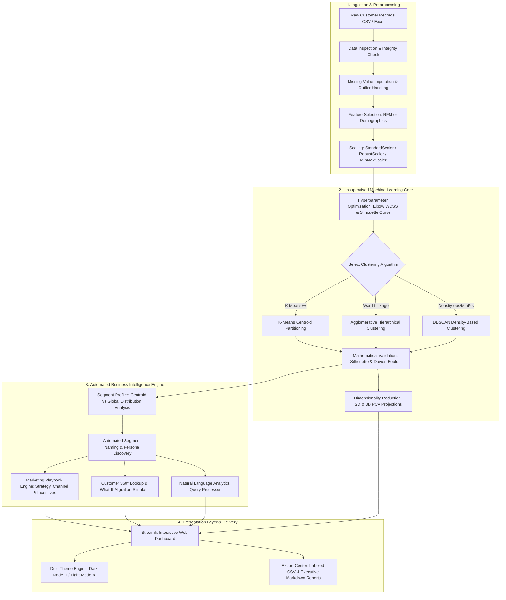

# 🛍️ SmartSegment AI — Customer Segmentation & Personalized Marketing Recommendation System

[](https://python.org)
[](https://streamlit.io)
[](https://scikit-learn.org)
[](https://plotly.com)
[]()
[](LICENSE)

> **AIML Mini-Project:** An enterprise-grade, unsupervised machine learning web platform that autonomously clusters customers by purchasing behaviour, translates statistical distributions into dynamic business personas, and generates targeted, channel-specific marketing activation playbooks.

---

## 📑 Table of Contents
1. [Executive Summary & Problem Statement](#-executive-summary--problem-statement)
2. [End-to-End System Architecture](#-end-to-end-system-architecture)
3. [Technical Depth & Mathematical Formulations](#-technical-depth--mathematical-formulations)
   - [Feature Preprocessing & Standardization](#31-feature-preprocessing--standardization)
   - [RFM Feature Modeling](#32-rfm-analysis-principles)
   - [Clustering Algorithms](#33-clustering-algorithms)
   - [Cluster Evaluation Metrics](#34-mathematical-cluster-evaluation-metrics)
   - [Dimensionality Reduction (PCA)](#35-principal-component-analysis-pca)
4. [Application Core Capabilities & Tabs](#-application-core-capabilities--tabs)
5. [Automated Segment Profiling & Personas](#-automated-segment-profiling--personas)
6. [Personalized Marketing Playbooks](#-personalized-marketing-playbooks)
7. [Customer 360° Lookup & "What-If" Simulator](#-customer-360-lookup--what-if-simulator)
8. [Natural Language Analytics Query Engine](#-natural-language-analytics-query-engine)
9. [Dual Visual Themes (Dark & Light Modes)](#-dual-visual-themes-dark--light-modes)
10. [Repository Structure](#-repository-structure)
11. [Quick Start & Installation Guide](#-quick-start--installation-guide)
12. [College Viva Voce & Academic Q&A Guide](#-college-viva-voce--academic-qa-guide)
13. [License & Acknowledgements](#-license--acknowledgements)

---

## 🎯 Executive Summary & Problem Statement

In modern retail, traditional "blast marketing" (treating every customer identically) results in low conversion rates, wasted advertising spend, and accelerated customer churn. To maximize Customer Lifetime Value (CLV), businesses must group customers into homogeneous cohorts based on purchasing habits and execute tailored engagement strategies.

**SmartSegment AI** bridges the gap between raw unsupervised machine learning and strategic business execution:
- Ingests transaction records (RFM) or demographic benchmarks (Income & Spending Score).
- Evaluates mathematical compactness and separation to identify the true optimal number of clusters ($k$).
- Benchmarks multiple clustering paradigms (**K-Means**, **Agglomerative Hierarchical**, and **DBSCAN**).
- Replaces cryptic mathematical labels (`Cluster 0`, `Cluster 1`) with human-readable business personas (`Champions & VIPs`, `At-Risk Inactive Spenders`).
- Generates tactical marketing campaigns with channel suggestions, cadence, and discount policies.
- Includes a real-time **What-If migration simulator** and a **natural-language query engine**.

---

## 🏗️ End-to-End System Architecture



---

## 🔬 Technical Depth & Mathematical Formulations

### 3.1 Feature Preprocessing & Standardization
Unsupervised clustering algorithms rely predominantly on geometric distance metrics (e.g., Euclidean distance). When features possess differing physical units or scales (e.g., Annual Income in thousands of dollars vs purchase frequency between 1 and 20), high-magnitude features dominate distance computations. 

The pipeline supports three scaling formulations:

1. **Z-Score Standardization (`StandardScaler`):**
   Centers features around zero with unit standard deviation:
   $$z = \frac{x - \mu}{\sigma}$$
   where $\mu$ is the feature mean and $\sigma$ is the standard deviation.

2. **Robust Scaling (`RobustScaler`):**
   Utilizes median and Interquartile Range (IQR) for datasets containing significant transaction outliers:
   $$x_{\text{robust}} = \frac{x - Q_2(x)}{Q_3(x) - Q_1(x)}$$

3. **Min-Max Scaling (`MinMaxScaler`):**
   Normalizes variables into a fixed $[0, 1]$ interval:
   $$x_{\text{norm}} = \frac{x - x_{\min}}{x_{\max} - x_{\min}}$$

---

### 3.2 RFM Analysis Principles
For e-commerce transaction intelligence, raw events are condensed into three behavioral features:
- **Recency ($R$):** Elapsed days since the customer's most recent transaction:
  $$R_i = \text{Date}_{\text{analysis}} - \max(\text{Date}_{\text{purchase}}^{(i)})$$
- **Frequency ($F$):** Total transaction count over the observation window:
  $$F_i = \sum_{t} \mathbb{I}(\text{Customer} = i)$$
- **Monetary ($M$):** Cumulative spending across all transactions:
  $$M_i = \sum_{k \in \text{Purchases}_i} \text{Amount}_k$$

---

### 3.3 Clustering Algorithms

#### A. K-Means Clustering (`k-means++` Initialization)
Partitions $N$ observations into $K$ disjoint clusters $S = \{S_1, S_2, \dots, S_K\}$, iteratively minimizing the Within-Cluster Sum of Squares (Inertia/WCSS):

$$\text{WCSS} = \sum_{j=1}^{K} \sum_{x \in S_j} ||x - \mu_j||^2$$

where $\mu_j = \frac{1}{|S_j|} \sum_{x \in S_j} x$ is the mathematical centroid of cluster $S_j$.
- **Initialization:** Employs `k-means++` sampling, choosing initial centers with probability proportional to the squared distance from the closest existing center:
  $$P(x) = \frac{D(x)^2}{\sum_{x' \in X} D(x')^2}$$
  This avoids suboptimal local minima typical of purely random initializations.

#### B. Hierarchical Agglomerative Clustering
Bottom-up clustering starting with each point as its own cluster and iteratively merging pairs based on **Ward's Minimum Variance Criterion**:
$$\Delta \text{ESS}_{AB} = \frac{n_A n_B}{n_A + n_B} ||\mu_A - \mu_B||^2$$
Ward's method minimizes total within-cluster variance increase at each step, yielding compact, spherical clusters.

#### C. DBSCAN (Density-Based Spatial Clustering of Applications with Noise)
Discovers clusters of arbitrary shape and isolates anomalous noise points without specifying $k$ a priori:
- A point $p$ is a **Core Point** if:
  $$|N_\varepsilon(p)| \ge MinPts, \quad \text{where } N_\varepsilon(p) = \{q \in D \mid \text{dist}(p, q) \le \varepsilon\}$$
- Points that are density-reachable from a core point form a cluster. Points not reachable from any core point are labeled as **Noise ($-1$)**.

---

### 3.4 Mathematical Cluster Evaluation Metrics

#### A. Silhouette Coefficient
Evaluates how well-separated and tightly grouped clusters are. For sample $i$:
$$s(i) = \frac{b(i) - a(i)}{\max(a(i), b(i))}$$
- $a(i)$: Mean intra-cluster distance between sample $i$ and all other points in cluster $S_A$:
  $$a(i) = \frac{1}{|S_A| - 1} \sum_{j \in S_A, j \neq i} d(i, j)$$
- $b(i)$: Mean nearest-cluster distance between sample $i$ and points in neighboring cluster $S_C$:
  $$b(i) = \min_{C \neq A} \left( \frac{1}{|S_C|} \sum_{j \in S_C} d(i, j) \right)$$
- The overall **Silhouette Score** is the mean over all samples:
  $$\text{Score}_{\text{sil}} = \frac{1}{N} \sum_{i=1}^{N} s(i) \in [-1, +1]$$

#### B. Davies-Bouldin Index
Measures the average similarity ratio between each cluster and its most similar counterpart. Lower values indicate superior cluster separation:
$$DB = \frac{1}{K} \sum_{i=1}^{K} \max_{j \neq i} \left( \frac{\sigma_i + \sigma_j}{d(\mu_i, \mu_j)} \right)$$
where $\sigma_i$ is average distance from points in cluster $i$ to centroid $\mu_i$, and $d(\mu_i, \mu_j)$ is distance between centroids.

#### C. Calinski-Harabasz Index (Variance Ratio Criterion)
Ratio of between-cluster dispersion to within-cluster dispersion:
$$CH = \frac{\text{Tr}(B_K)}{\text{Tr}(W_K)} \times \frac{N - K}{K - 1}$$
Higher values signify dense, well-separated clusters.

---

### 3.5 Principal Component Analysis (PCA)
To project high-dimensional feature spaces onto 2D and 3D visual coordinates:
1. Compute the empirical covariance matrix:
   $$\Sigma = \frac{1}{N-1} X^T X$$
2. Perform Eigendecomposition:
   $$\Sigma v_i = \lambda_i v_i$$
3. Sort eigenvectors $v_i$ by descending eigenvalues $\lambda_i$.
4. Calculate explained variance ratio for component $k$:
   $$\text{EVR}_k = \frac{\lambda_k}{\sum_{j=1}^P \lambda_j}$$

---

## 💻 Application Core Capabilities & Tabs

The Streamlit web application is structured into **8 modular analytics centers**:

| Tab | Name | Capabilities & Business Value |
| :---: | :--- | :--- |
| **1** | **📊 Dataset & EDA** | Inspect raw datasets, view memory profiling, missing value verification, duplicate checks, and feature distribution histograms with marginal box plots. |
| **2** | **🧠 Model Evaluation** | Simultaneous **Elbow Method (WCSS vs $k$)** and **Silhouette Curve ($k=2 \dots 8$)** to identify the algorithmic peak optimal $k$. |
| **3** | **📈 Multi-Dimensional Visualizer** | Interactive 2D scatter with centroids, 3D rotating cluster space, 2D PCA projection coordinates, and normalized multi-variable Radar/Spider charts. |
| **4** | **🏷️ Automated Segment Personas** | Converts raw cluster IDs into business personas with customer counts, population share, statistical trait bullets, and cluster benchmark comparison tables. |
| **5** | **🎯 Targeted Marketing Playbooks** | Generates campaign blueprints for each cohort: Campaign Objectives, Delivery Channels, Suggested Campaign Titles, Discount Guidelines, and Cadence. |
| **6** | **🔍 Customer 360° & Simulator** | Search individual customer IDs to inspect their cluster traits, persona badge, and deviation from segment averages; interactive sliders to simulate **"What-If"** cluster migration. |
| **7** | **💬 Smart Natural Language Query** | Rule-assisted natural language engine that answers analytical business questions (*"Which segment spends the most?"*, *"Who are the at-risk customers?"*) in plain English. |
| **8** | **📥 Export Center** | Download the labeled customer dataset with cluster IDs and persona names as CSV, or download an executive markdown report for boardroom presentations. |

---

## 🏷️ Automated Segment Profiling & Personas

Rather than leaving business stakeholders to decipher `Cluster 0` or `Cluster 3`, the **Segment Profiling Engine** evaluates cluster centroids against global dataset distributions:

- **👑 Champions & High-Value VIPs:** High monetary value, frequent purchases, low recency (recent activity).
- **🛍️ Loyal Frequent Shoppers:** Consistently high transaction counts, steady recency, moderate-to-high spending.
- **⚡ Promising / Active Spenders:** Recent customers with growing frequencies; high responsiveness to engagement.
- **⚠️ At-Risk Inactive Spenders:** High historical monetary value who haven't made a transaction in a prolonged window (high recency). Immediate churn threat!
- **📦 Hibernating / Budget-Conscious:** Low transaction frequencies, modest budgets, discount-sensitive.

---

## 🎯 Personalized Marketing Playbooks

For every discovered segment, the system produces actionable campaign playbooks:

```
┌────────────────────────────────────────────────────────────────────────┐
│ 👑 Segment: Champions & High-Value VIPs (Share: 24.5%)                 │
├────────────────────────────────────────────────────────────────────────┤
│ • Strategic Objective: VIP Retention & Lifetime Value Maximization     │
│ • Action Priority:     High (Protect Core Revenue)                     │
│ • Recommended Channels:Dedicated Concierge, Private In-App Lounge,     │
│                        Exclusive Email Invitations                     │
│ • Suggested Campaign:  Platinum Elite Preview & White-Glove Perks      │
│ • Recommended Offer:   Early access to product drops + zero-threshold  │
│                        free express shipping + invite-only events.     │
│ • Discount Policy:     Avoid heavy percentage markdowns; offer luxury  │
│                        gifts-with-purchase or experiential rewards.    │
│ • Contact Cadence:     Curated, low frequency (1-2 contacts / month)   │
└────────────────────────────────────────────────────────────────────────┘
```

---

## 🔮 Customer 360° Lookup & "What-If" Simulator

1. **Individual Lookup:**
   Enter or select any `CustomerID` to view the customer's specific metric values alongside the cluster benchmark, relative deviations, and immediate recommended activation campaign.

2. **Hypothetical What-If Migration:**
   Adjust dynamic sliders representing customer features (e.g., increasing `Annual Income` or reducing `Recency`). The trained model transforms the simulated feature vector through the scaler pipeline and computes centroid assignment, displaying which persona cohort the customer shifts into in real-time.

---

## 💬 Natural Language Analytics Query Engine

Enables non-technical executives and marketing managers to ask direct business questions without writing code or SQL:
- *"Which customer segment spends the most?"*
- *"How many customers belong to each segment?"*
- *"Who are the at-risk customers?"*
- *"Which segment should receive loyalty offers?"*
- *"Which is the largest segment?"*

Responses include automated quantitative answers, group breakdowns, and metric highlights.

---

## 🌓 Dual Visual Themes (Dark & Light Modes)

The interface includes a dedicated **Appearance Mode** toggle located at the top of the sidebar:

- **🌙 Dark Mode:** Deep slate canvas (`#0B0F19` / `#111827`), glowing accents, glass-effect metric cards, and synchronized `plotly_dark` charts.
- **☀️ Light Mode:** Crisp white canvas (`#FFFFFF` / `#F8FAFC`), subtle borders (`#E2E8F0`), indigo-to-blue executive banner, high-contrast typography, and synchronized `plotly_white` charts.
- **Unified Widget Styling:** Selectboxes, sliders, expanders, alert boxes, text inputs, radio pills, and data tables automatically adapt to the chosen visual mode with consistent contrast and zero UI clashes.

---

## 📁 Repository Structure

```
d:/AIML/mini project/
├── .streamlit/
│   └── config.toml                     # Streamlit theme and server configuration
├── data/
│   ├── mall_customers.csv              # Mall customer demographic dataset (200 records)
│   └── online_retail_rfm.csv           # Online Retail RFM transaction dataset (1,000 records)
├── notebooks/
│   └── customer_segmentation_walkthrough.ipynb # Step-by-step Jupyter Notebook walkthrough
├── src/
│   ├── __init__.py                     # Package initialization
│   ├── data_loader.py                  # Ingestion, validation, preprocessing, schema profiling
│   ├── ml_pipeline.py                  # Scaling, K-Means, DBSCAN, PCA, WCSS & Silhouette metrics
│   ├── segment_profiler.py             # Statistical centroid profiling & automated persona naming
│   ├── recommendation_engine.py        # Tactical marketing playbooks & customer 360 analysis
│   └── query_engine.py                 # Natural Language Analytics query parser
├── app.py                              # Streamlit interactive multi-tab web application
├── create_datasets.py                  # Synthetic/preloaded dataset generator script
├── requirements.txt                    # Project dependencies
├── PROJECT_REPORT.md                   # Full academic project documentation & Viva Q&A
├── .gitignore                          # Git ignore rules (pycache, env, logs)
└── README.md                           # Comprehensive project documentation
```

---

## 🚀 Quick Start & Installation Guide

### Prerequisites
- Python 3.9, 3.10, or 3.11 installed on your system.
- Git installed.

### 1. Clone the Repository
```bash
git clone https://github.com/Prathemsh-Coder/AIML-MICRO-PROJECT.git
cd AIML-MICRO-PROJECT
```

### 2. Set Up a Virtual Environment (Recommended)
```bash
# Windows
python -m venv venv
.\venv\Scripts\activate

# macOS / Linux
python3 -m venv venv
source venv/bin/activate
```

### 3. Install Required Dependencies
```bash
pip install -r requirements.txt
```

### 4. Verify Datasets (Optional)
If datasets need to be regenerated:
```bash
python create_datasets.py
```

### 5. Launch the Streamlit Web Application
```bash
streamlit run app.py
```

Once running, navigate to **`http://localhost:8501`** in your browser.

---

## 🎓 College Viva Voce & Academic Q&A Guide

**Q1: Why is customer segmentation formulated as an unsupervised machine learning task?**
> *Answer:* In transactional customer databases, there are no predefined ground-truth labels indicating which segment a customer belongs to. Unsupervised clustering algorithms discover intrinsic patterns, boundaries, and densities directly from the mathematical feature space.

**Q2: Why is feature standardization non-negotiable for K-Means?**
> *Answer:* K-Means optimizes for minimum Euclidean distance between points and centroids. If one feature has values in thousands (e.g., Monetary spending $\approx \$5,000$) and another has values below 10 (e.g., Frequency $\approx 4$), the distance metric will be dominated entirely by Monetary, rendering Frequency negligible. Standardization ensures equal geometric weighting.

**Q3: How do you mathematically determine the optimal cluster count ($k$)?**
> *Answer:* We employ two complementary metrics:
> 1. **Elbow Method:** Plots Within-Cluster Sum of Squares (WCSS) against $k$ and identifies the inflection point where marginal variance reduction diminishes.
> 2. **Silhouette Score:** Measures intra-cluster cohesion versus inter-cluster separation ($s(i) \in [-1, 1]$). The $k$ corresponding to the global peak silhouette score represents the mathematical optimum.

**Q4: How does DBSCAN differ from K-Means in customer segmentation?**
> *Answer:* K-Means assumes spherical, equally-sized clusters and forces every customer (even severe outliers) into a cluster. DBSCAN clusters based on density reachability ($\varepsilon$ radius and $MinPts$) and can identify arbitrary non-linear cluster shapes while isolating anomalous noise customers as cluster $-1$.

**Q5: What are the three components of RFM analysis and why are they effective?**
> *Answer:* **Recency** (days since last purchase), **Frequency** (total purchases), and **Monetary Value** (total spend). Academic and industrial marketing literature proves that these three dimensions capture the recency of interest, brand loyalty, and direct economic value of customers.

---

## 📜 License & Acknowledgements

This project was developed for the **AIML Mini-Project** curriculum. 
- Open-source under the [MIT License](LICENSE).
- Built with [Streamlit](https://streamlit.io), [Scikit-Learn](https://scikit-learn.org), and [Plotly](https://plotly.com).
- Author: **Prathamesh Raut** ([GitHub](https://github.com/Prathemsh-Coder))
